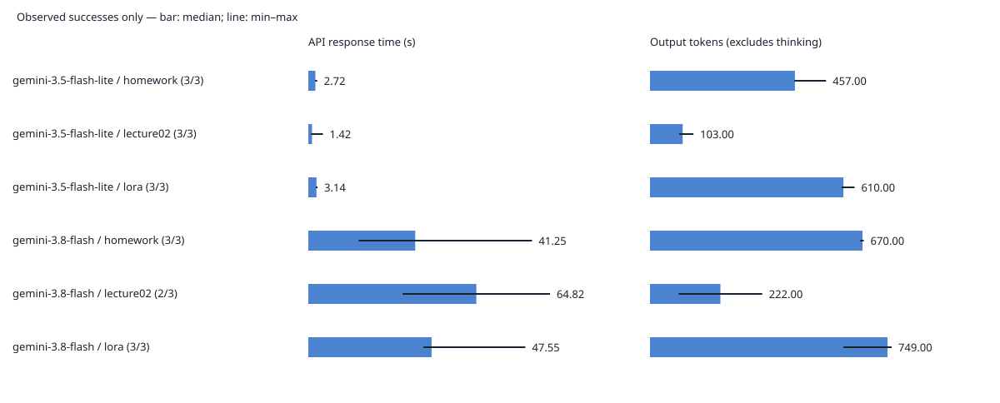

# 第1回 解答

## 演習

- 講座に固有の質問（宿題の3レベル）へのモデルの回答（要約でよい）：gemini-3.5-flash-liteは、一般的な難易度区分として「基礎・入門」「応用・実践」「発展・挑戦」を説明し、正確な条件は教材で確認するよう勧めた。
- 用語集の正しい意味と比べて気づいたこと：用語集の「基礎・実装・発展」とは名称や説明が異なり、「どれか1つで完了」という条件も答えられなかった。「一般的に」と留保しており、講座固有の情報を把握していないことが分かった。
- 表示できたトークン数（入力 / 出力本文）：LoRAについて質問した実行では、入力7、出力本文637だった。

## 宿題

- 取り組んだレベル：発展＋α（反復測定・記録の再現性・講座固有の質問への正確さの評価）
- 実施内容：2モデル×3質問×3回の18試行で、応答時間・トークン数・回答本文・失敗を保存し、成功時の中央値と最小・最大を比較した。
- 結果：17回成功、1回HTTP 504。Flash Liteは9/9成功、Flashは8/9成功。今回の条件では全質問でFlash Liteの応答時間の中央値が短かった。

### 実験条件

- 最初／最後の試行開始日時（JST）：2026-11-02T12:25:23.580682+09:00 ／ 2026-11-02T12:40:07.764252+09:00。最終応答完了時刻とは区別する。
- Python・SDK・実行コミット：{"python": "3.12.16", "google_genai": "2.31.0", "git_commit": "330c06e51b562b9d1849649618b27d19296805db"}
- 指定モデルと成功応答の返却モデル名：gemini-3.5-flash-lite、gemini-3.8-flash。
- 実行場所：GitHub Codespaces。講座のuv.lockによる固定依存。
- 質問：LoRAとは何ですか？／AIE2026の講座の宿題にある「3レベル」とは何ですか？／AIE2026の第2回では何を学びますか？
- 各リクエストは独立。会話履歴、検索ツール、講座資料はモデルに渡していない。
- 生成設定：モデル既定。temperatureの上書きなし。モデルごとに既定設定が異なり得る。
- 呼び出し完了後に15秒待機。実行順序のseedは42、ラウンド内で順序を混ぜた。回答を固定するseedではない。
- SDKの自動再試行は無効（attempts=1）、タイムアウト設定は120秒。失敗を自動で成功に置き換えない。
- perf_counterでAPI呼び出しから応答完了までを測定した。ネットワーク・サーバー待ち等を含み、呼び出し間の15秒待機や保存処理は含めない。
- 実験条件と原記録：[config.json](results/free-tier/config.json)、[results.jsonl](results/free-tier/results.jsonl)。

### 実測結果

成功した応答のみで集計した。トークン数の欠損は0に置き換えない。
出力トークン数は回答本文であり、推論用トークン数とは別である。
推論用・総トークン数も原ログと集計CSVに保持している。

|モデル|質問|成功/試行|秒 中央値|秒 最小～最大|入力 中央値|出力 中央値|出力の有効件数|
|---|---|---:|---:|---|---:|---:|---:|
|gemini-3.5-flash-lite|homework|3/3|2.72|2.61～3.44|21.00|457.00|3|
|gemini-3.5-flash-lite|lecture02|3/3|1.42|1.04～5.62|17.00|103.00|3|
|gemini-3.5-flash-lite|lora|3/3|3.14|2.90～3.55|7.00|610.00|3|
|gemini-3.8-flash|homework|3/3|41.25|19.39～86.31|21.00|670.00|3|
|gemini-3.8-flash|lecture02|2/3|64.82|36.41～93.23|17.00|222.00|2|
|gemini-3.8-flash|lora|3/3|47.55|44.41～83.73|7.00|749.00|3|

棒は中央値、横線は最小～最大。図中の件数は成功数／試行数。
[詳細集計CSV](results/free-tier/summary.csv)と[回答原文を含む集計](results/free-tier/summary.md)も添付する。

### 失敗と環境変更

本実験ではr1-m1-lecture02が118.76秒後にHTTP 504（ServerError）となった。
この時間を成功時の中央値へ混ぜず、該当条件の有効件数を2件とした。
504は429のレート制限とは異なり、内部のどの処理が遅延したかはログだけでは分からない。

本実験の前に、従来のTier 1プロジェクトで1試行を実行し、0.36秒後にHTTP 402（ClientError）となった。
演習専用Free Tierプロジェクトを作成し、利用環境を切り替えた。
CodespacesのSecretを新しいAPIキーへ変更し、再起動して本実験を行った。
402の[予備実行ログ](results/main/results.jsonl)と[条件](results/main/config.json)は、無料枠の18試行と分離して保存した。
APIキーは提出物に含めない。

### 無料枠のレート制限との関係

実行前に新しいプロジェクトのAI Studio画面で次の上限を確認した（2026-11-02）。

|モデル|RPM|TPM（入力）|RPD|
|---|---:|---:|---:|
|gemini-3.5-flash-lite|15|250000|500|
|gemini-3.8-flash|5|250000|20|

本実験の呼び出しは各モデル9回で、日次上限に対してLiteは1.8%、Flashは45%に相当する。
初回の1回を保存してから残り17回を再開したため、接続確認の成功分を重複実行していない。
失敗試行がサーバー側でどの利用枠に計上されたかは独立には確認していない。
画面の期間設定が過去7日であったため、表示値を当日の厳密な消費量や残量と読み替えてはいない。

15秒待機を入れた直列実行により、呼び出し頻度を抑えた。本実験では429は観測されなかった。
ただし上限に達する負荷試験は行っていないので、限界性能を検証したことにはならない。
今回の入力は短い一方、同じ実験を繰り返すとFlashの日次20回という上限が制約になりやすい。
残量は他の利用や失敗試行の扱いも考慮して確認する必要がある。

### ＋α：講座固有の質問の正確さ

評価範囲はhomeworkの6回答に限定した。LoRAと第2回の内容の回答は、この正確さ評価の対象外である。
参照先はdata/glossary.jsonのhomework-levels。
正しい定義は「基礎（講義内容の確認）・実装（自分でコードを書く）・発展（調査や試行）」で、どれか1つに取り組めば完了し、原則採点はしない。

評価はCodexによる原文と用語集の照合であり、独立した複数評価者による判定ではない。
重要な説明は近いが正式な区分や完了条件を欠く場合は「一部誤り」、講座と整合しない必須・合格・加点基準を提示する場合は「誤り」とした。
不確かさの明示と内容の正確さを区別し、一般論との留保だけを理由に正解とはしなかった。

|モデル|正しい|一部誤り|誤り|分からないと回答|
|---|---:|---:|---:|---:|
|gemini-3.5-flash-lite|0|3|0|0|
|gemini-3.8-flash|0|0|3|0|

Flash Liteの3回答は一般例として基礎・応用・発展を説明したが、正式な区分と「どれか1つで完了」が不足した。
Flashの3回答は、必須ライン・修了要件・高評価など、講座の定義にない達成基準を提示した。
3回目にはAI活用の深度という別の定義も候補として挙げた。
各回答の評価理由は[evaluation.csv](results/free-tier/evaluation.csv)に保存した。対象外の12行は評価欄を空欄のまま保持している。

### 考察と限界

今回、Flashは全質問で出力本文トークン数の中央値が多く、応答時間も長かった。
ただし、時間差を回答の長さだけで説明することはできない。推論処理、モデル設定、通信、混雑などが影響し得るためである。
出力トークン数を経過秒数で割っても、モデル内部だけの純粋な生成速度にはならない。

homeworkでは、より長く具体的な回答が講座固有の情報の正確さを保証しなかった。
Flash Liteが短時間で応答したことと、正しい講座ルールを答えられたことは別であり、両モデルとも今回の6回答では完全な正解に至らなかった。
モデルへ講座資料を渡していないため、回答を用語集と照合する必要がある。
資料を渡すことによる改善効果は、今回は実験していない。

各条件3回、1条件は成功2回という小規模な測定であり、一般的なモデルの優劣は断定しない。
成功時の中央値だけを見ると504による待ち時間を見落とすため、失敗数と失敗までの時間も併記した。
同じ条件でも応答が変わること、失敗も残して有効件数を明記することが比較実験に必要だと分かった。

### AIツールの利用と実施の分担

Codexを実験設計、計測・保存・集計コード、テスト、回答評価、提出文の整理に利用した。
受講者がCodespacesで演習と本実験を実行し、APIキー切替・無料枠・実行結果を確認した。
CSVの評価と本解答の仕上げは、受講者の依頼に基づきCodexが支援した。
自動テストの偽応答と、今回のGemini APIによる実測ログを区別した。

### 参照資料

- 講座のlectures/01/problem.md、演習資料p.14–16、data/glossary.jsonのhomework-levels。
- [Gemini APIのレート制限](https://ai.google.dev/gemini-api/docs/rate-limits)
- [Gemini APIの前払い課金](https://ai.google.dev/gemini-api/docs/billing#prepay)
