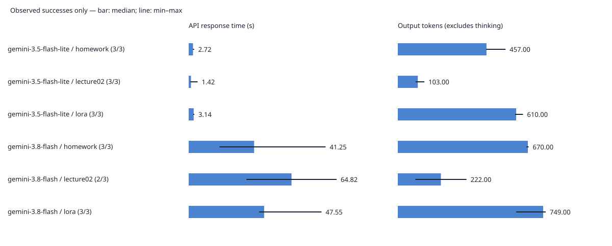

# 実測データの集計

成功した応答のみを集計。欠損値は0に置き換えない。正確さは未評価。
再実行すると本集計は更新される。考察はanswer.mdへ記入する。

|モデル|質問|成功/試行|秒 中央値|秒 最小～最大|入力 中央値|出力 中央値|出力の有効件数|
|---|---|---:|---:|---|---:|---:|---:|
|gemini-3.5-flash-lite|homework|3/3|2.72|2.61～3.44|21.00|457.00|3|
|gemini-3.5-flash-lite|lecture02|3/3|1.42|1.04～5.62|17.00|103.00|3|
|gemini-3.5-flash-lite|lora|3/3|3.14|2.90～3.55|7.00|610.00|3|
|gemini-3.8-flash|homework|3/3|41.25|19.39～86.31|21.00|670.00|3|
|gemini-3.8-flash|lecture02|2/3|64.82|36.41～93.23|17.00|222.00|2|
|gemini-3.8-flash|lora|3/3|47.55|44.41～83.73|7.00|749.00|3|

## 失敗・空応答

- r1-m1-lecture02: error, HTTP=504。成功時の統計から除外。

## 回答原文（評価用）

### r1-m1-lora

モデル: gemini-3.8-flash / 質問: LoRAとは何ですか？

<pre>**LoRA（Low-Rank Adaptation：ロー・ランク・アダプテーション）**とは、AI分野において、大規模なAIモデル（画像生成AIや大規模言語モデルなど）を**「少ない計算量」「小さなデータサイズ」「短い時間」で効率的に追加学習（ファインチューニング）させる技術**です。

2021年にMicrosoftの研究者らによって提案されました。

分かりやすく理解できるように、背景や仕組み、メリットを解説します。

---

### 1. なぜLoRAが必要になったのか？（背景）
ChatGPTのような大規模言語モデル（LLM）や、Stable Diffusionのような画像生成AIは、非常に巨大な「重み（パラメータ）」を持っています。

これらを特定の用途（例：特定のキャラクターを描く、医療専門の受け答えをさせる）向けにカスタマイズ（従来のファインチューニング）しようとすると、以下の問題がありました。

* **莫大な計算コスト:** 超高性能なGPUが大量に必要。
* **巨大なファイルサイズ:** 調整するたびに、数十GB〜数百GBのモデル全体を丸ごと再保存しなければならない。

### 2. LoRAの仕組み（例え話）
LoRAは、**「分厚い辞書（元のモデル）を書き換えるのではなく、数枚の『付箋（LoRA）』を貼って補足する」**というアプローチを取ります。

* **元モデルは凍結:** 巨大な元モデルのパラメータは一切書き換えません。
* **小さな計算（低ランク行列）だけを追加:** 元のモデルの横に、極めて小さな計算用の通り道（低ランク行列）を付け足し、**その小さな部分だけを学習**させます。

これにより、必要な計算量と保存するデータ量を劇的に減らすことに成功しました。

### 3. LoRAの主なメリット
1. **ファイルサイズが圧倒的に小さい**
   * 元のモデルが数GB〜数十GBあるのに対し、LoRAのファイルは**数MB〜数百MB**程度で済みます。
2. **家庭用のPC（GPU）でも学習が可能**
   * 必要なGPUメモリ（VRAM）が大幅に削減されるため、高価なサーバーがなくても個人のゲーミングPC等で追加学習ができます。
3. **着脱や組み合わせが自由自在**
   * 元のモデルを汚さないため、「LoRA A（特定の絵柄）」と「LoRA B（特定の服装）」を**同時に適用したり、ワンクリックで切り替えたり**できます。

### 4. 具体的にどこで使われている？

* **画像生成AI（Stable Diffusionなど）**
  * 最も身近で普及している分野です。「特定のキャラクターの顔」「特定のアニメ作家の画風」「特定のポーズや衣装」などを学習させたLoRAが、世界中のユーザーによって共有されています。
* **テキスト生成AI（LLM）**
  * Llama 3などのオープンソースモデルに対し、「自社のマニュアルを学習させる」「特定のキャラクターのような口調で喋らせる」「プログラミング言語に特化させる」といった用途で広く使われています。

### まとめ
LoRAは、**「巨大なAIモデルを、個人や中小企業でも手軽に・安く・自在にカスタマイズできるようにした画期的な技術」**です。

※なお、IoT通信技術にも同名の「LoRa（Long Range）」がありますが、AIの文脈で語られるLoRAとは全くの別物です。</pre>

### r1-m0-homework

モデル: gemini-3.5-flash-lite / 質問: AIE2026の講座の宿題にある「3レベル」とは何ですか？

<pre>AIE2026（AIエンジニア育成講座などの2026年目標のプログラムを指していると推測されます）の宿題における「3レベル」という言葉は、多くの場合、**「受講生のスキルや理解度に合わせて、難易度や課題の深度を3段階に分けて出題されている課題」**を指します。

一般的なプログラミングやAIの講座では、以下のような構成で「3レベル」が設定されていることがよくあります。

### 一般的な「3レベル」の構成例

1. **レベル1（基礎・ベーシック）**
   * **目的:** 授業内容の基本構文や、用語・概念が理解できているかの確認。
   * **内容:** 穴埋め問題、コードの写経、非常にシンプルな実行確認など。
2. **レベル2（応用・スタンダード）**
   * **目的:** 学んだ知識を組み合わせて、自分でコードを書けるかの確認。
   * **内容:** 条件分岐やループを使った少し実用的なプログラムの作成、エラーの修正（デバッグ）など。
3. **レベル3（発展・アドバンスド）**
   * **目的:** 応用力を試し、より実践的・効率的なコードを自分で考える力の育成。
   * **内容:** 複雑なアルゴリズムの実装、オープンな課題解決、リファクタリング（コードの最適化）など。

---

### 注意すべきポイント
※もしこれが特定のプラットフォームや特定の講師の方による「特定のフレームワーク（例：思考の3レベル、プロンプトの3レベルなど）」を指している場合は、上記とは異なる定義がされている可能性があります。

もし確実な定義を知りたい場合は、以下のいずれかをご確認いただくことをお勧めします。
* 宿題が掲載されているページの「はじめに」や「概要説明」
* 講座のSlackやDiscordなどのコミュニティ、またはチャットでの質問

もし具体的な問題の内容（コードや文章など）のテキストがあれば、それを教えていただければ、どのレベルに該当するか、あるいはどのような意図の3レベルなのかをより正確にお答えできるかもしれません。</pre>

### r1-m0-lecture02

モデル: gemini-3.5-flash-lite / 質問: AIE2026の第2回では何を学びますか？

<pre>申し訳ありませんが、「AIE2026」という特定のイベントやプログラム（セミナー、学会、研修、コンテストなど）に関する詳細な情報を持ち合わせていません。

「AIE2026」の正式名称や、それが開催される文脈（主催している企業、学校、学会など）を教えていただければ、手元にある情報からお答えできるか確認いたします。もしお手元にプログラムの概要や公式サイトのリンク等があれば、その内容を教えていただけますでしょうか？</pre>

### r1-m1-homework

モデル: gemini-3.8-flash / 質問: AIE2026の講座の宿題にある「3レベル」とは何ですか？

<pre>東京大学・松尾研究室などが主催するAIエンジニア育成講座（AIE：AI Engineer Course 等）における宿題の**「3レベル」**とは、受講生の習熟度や目標に合わせて設定されている**課題の難易度（達成基準）**のことです。

一般的に、各課題（Kaggle形式のコンペティションや実装課題など）において、以下のような3段階で定義されています。

---

### 1. レベル1：基礎・必修ライン（Baseline達成）
* **対象：** 全受講生（修了要件に関わる最低基準）
* **内容：**
  * 配布されたベースラインコード（ひな型）の動作確認と理解。
  * 講義で扱った基本的なモデルや前処理を実装し、指定された最低限のスコア（ベンチマーク）をクリアすること。
* **目的：** タスクの全体像（データ読み込みから推論、提出までの一連の流れ）を掴む。

### 2. レベル2：標準・応用ライン（標準的な合格目標）
* **対象：** AIエンジニアとして実践的な基礎力をつけたい受講生
* **内容：**
  * 講義で学んだ標準的な発展手法（特徴量エンジニアリング、代表的なモデルの適用、ハイパーパラメータの調整、適切な交差検証の設計など）の実装。
  * レベル1より一段階高いスコア基準を達成すること。
* **目的：** 自身の手でモデルの改善サイクルを回し、汎用的なモデリング手法を身につける。

### 3. レベル3：発展・挑戦ライン（高難度・上位入賞目標）
* **対象：** 実務経験者、Kaggle上位を目指す人、さらなる高みを目指す受講生
* **内容：**
  * 最新の論文やSOTA（State-of-the-Art）手法の調査・実装。
  * 複数モデルのアンサンブルやスタッキング、高度な後処理などの適用。
  * コンペティション形式の場合、リーダーボードの上位に食い込むスコアの達成。
* **目的：** 自律的に課題を分析し、未踏の解法を探究する高度な問題解決力を身につける。

---

### 取り組み方のアドバイス
* **修了要件の確認：** 講座の修了証を得るためには「レベル何以上の達成が必要か（通常はレベル1またはレベル2）」をシラバス等で必ず確認してください。
* **段階的なアプローチ：** 最初からレベル3を目指して詰まるよりも、まずは確実に**「レベル1」を動かして提出を完了させてから**、レベル2、レベル3へと順に改善を加えていくのが推奨されます。

※特定のモジュール（LLM、画像、強化学習など）によって細かな達成条件の文言が異なる場合がありますので、詳細は各課題のREADMEや配布ノートブックの冒頭にある「評価基準」をご確認ください。</pre>

### r1-m0-lora

モデル: gemini-3.5-flash-lite / 質問: LoRAとは何ですか？

<pre>**LoRA（ローラ）**とは、AI（特に大規模言語モデルや画像生成AI）の分野で使われる技術の名前で、**「Low-Rank Adaptation（低ランク適応）」**の略です。

一言で言うと、**「AIの頭脳全体を書き換えることなく、一部だけを効率よく追加学習させて、新しい才能（スタイルや知識）を覚え込ませる技術」**です。

---

### LoRAの何がすごいの？（従来の課題と解決）

これまでのAIの微調整（ファインチューニング）には大きな問題がありました。それは**「莫大なコストと手間がかかる」**ということです。

* **従来の方法：** AIの頭脳を構成するすべてのパラメータ（数百億〜数千億個）を書き換える必要があり、スーパーコンピューターのような巨大な計算パワーと、膨大なストレージ（1モデルあたり数十〜数百GB）が必要でした。
* **LoRAの方法：** AIの本体はそのまま動かさず、その横に**「メモ用紙（数MB〜数百MB程度の小さな追加ファイル）」**をペタッと貼るようなイメージで学習を行います。

### LoRAの3大メリット

1. **圧倒的に軽量（省ストレージ）**
   * 元のAIモデルが数十GBあるのに対し、LoRAのファイルは**数MB〜数十MB**程度で済みます。そのため、個人のパソコンでも簡単に共有・保存ができます。
2. **学習コストが低い（省電力・低コスト）**
   * パラメータのほんの一部（1%未満など）しか学習しないため、一般的なグラフィックボード（GPU）を積んだパソコンでも短時間で学習が可能です。
3. **簡単に切り替えられる**
   * 本体は1つだけ持っておき、好みに応じて「アニメ風のLoRA」「特定の画風のLoRA」「専門知識のLoRA」などをパズルのピースのように自由に着せ替えることができます。

---

### どんなところで使われているの？

現在、主に以下の分野で爆発的に普及しています。

* **画像生成AI（Stable Diffusionなど）：**
  特定のアニメキャラ、画風、人物、ポーズなどをAIに学習させるために必須の技術になっています。「〇〇風のイラストを描くLoRA」などがネット上で数多く配布されています。
* **大規模言語モデル（LLM、ChatGPTのオープンソース版など）：**
  特定のキャラクターになりきらせたり、社内マニュアルを覚えさせて特定の業務に特化させたりするために使われています。

### まとめ

LoRAとは、**「AIの巨大な本体はいじらず、小さくて賢い『あとづけの追加パーツ』を作ることで、誰でも簡単にAIをカスタマイズできるようにした画期的な技術」**です。</pre>

### r1-m1-lecture02

モデル: gemini-3.8-flash / 質問: AIE2026の第2回では何を学びますか？

<pre>（回答なし）</pre>

### r2-m1-lora

モデル: gemini-3.8-flash / 質問: LoRAとは何ですか？

<pre>**LoRA（Low-Rank Adaptation：ロー・ランク・アダプテーション）**とは、巨大なAIモデル（LLMや画像生成AIなど）を、**「少ない計算量」「小さなデータサイズ」「短い時間」で効率的に追加学習（ファインチューニング）させるための技術**です。

2021年にマイクロソフトの研究者たちによって提案され、現在ではChatGPTのような言語モデルだけでなく、Stable Diffusionなどの画像生成AIの分野でも爆発的に普及しています。

---

### LoRAのイメージ（例え話）

従来の追加学習が**「分厚い教科書（巨大なモデル）の全ページを書き直す」**ようなものだとすれば、LoRAは**「教科書本体には手を触れず、重要な修正点や追加情報だけを『透明なシート（付箋）』に書いて上から重ねる」**ようなイメージです。

元の巨大な知識はそのまま保持しつつ、特定のキャラクター、画風、専門用語など「追加したい特徴」だけをピンポイントで学習させます。

---

### 主な特徴とメリット

1. **ファイルサイズが劇的に小さい**
   * 通常のモデルを丸ごと学習させると数GB〜数十GBの巨大なファイルになりますが、LoRAなら**数MB〜数百MB程度**で済みます。
2. **少ないパソコンのスペック（VRAM）で学習できる**
   * 一般家庭用のグラフィックボード（GPU）でも短時間で学習が可能です。
3. **着脱や組み合わせが自由**
   * 元のモデルに「LoRA A（特定のキャラ）」と「LoRA B（特定の画風）」を重ねがけして適用したり、不要になったら簡単に外したりできます。

---

### 主な活用例

LoRAは特に以下の2つの分野でよく使われています。

#### 1. 画像生成AI（Stable Diffusionなど）
AIイラストの分野では日常的に使われており、特定の要素をAIに覚えさせるために重宝されています。
* **特定のアニメキャラクターや人物**の顔・姿
* **特定の絵柄・画風**（水彩画風、特定のアニメ風など）
* **特定のポーズや衣装、構図**

#### 2. 大規模言語モデル（LLM）
OpenAIのモデルやオープンソースの言語モデル（Llamaなど）を、特定の用途に特化させるために使われます。
* **専門知識の追加**（医療、法律、社内文書など）
* **キャラクターづけ・口調の変更**（ツンデレ風、関西弁、カスタマーサポート風など）

---

### まとめ

LoRAは、**「巨大なAIモデルを、個人のパソコンや限られた予算でも、手軽に自分好みにカスタマイズできるようにした画期的な技術」**です。</pre>

### r2-m0-lora

モデル: gemini-3.5-flash-lite / 質問: LoRAとは何ですか？

<pre>**LoRA（ローラ）**とは、AI（人工知能）、特に大規模言語モデル（LLM画像生成AI）の分野で使われる**「AIの効率的なカスタマイズ手法（技術）」**の名前です。

正式名称を **LoRA: Low-Rank Adaptation（低ランク適応）** と言います。

一言で言うと、**「AIの頭脳全体を書き換えるのではなく、一部の小さな『付箋』のような部分だけを追加して、特定のキャラクターや画風、専門知識を覚えさせる技術」**です。

---

### LoRAの何がすごいの？（メリット）

従来のAIのカスタマイズ（ファインチューニング）には、以下のような大きな問題がありました。
*   **莫大なコスト:** AIの全パラメータ（脳細胞のようなもの）を調整するため、膨大な計算能力と電気代がかかる。
*   **膨大なデータ容量:** カスタマイズするたびに、元のAIと同じくらいの巨大なファイル（数10GB〜数100GB）が保存用必要になる。

これに対して、LoRAはこの問題を劇的に解決しました。

1.  **圧倒的な軽量さ:**
    元のAIモデルには一切手を加えず、追加で学習させる部分はほんのわずか（全体の数％未満）です。そのため、生成されるファイルサイズが**数MB〜数100MB程度**と非常に小さくなります。
2.  **低コスト・短時間:**
    個人のパソコン（高性能なグラボが必要ですが）や、無料のクラウド環境でも短時間で学習させることができます。
3.  **簡単に切り替えが可能:**
    ベースとなるAIに、その「LoRAファイル」を「着せ替え人形」のようにパッと付け替えるだけで、様々なキャラクターやスタイルを出力させることができます。

---

### 具体的にどんなところで使われている？

現在、主に以下の2つの分野で爆発的に普及しています。

1.  **画像生成AI（Stable Diffusionなど）**
    *   特定のキャラクター（アニメキャラや実在の人物）をそっくりに描かせる。
    *   「水彩画風」「サイバーパンク風」など、特定の画風やタッチを学習させる。
    *   （例：ネット上で「〇〇（キャラクター名）のLoRA」がたくさん配布されており、それらをダウンロードして使われています）
2.  **大規模言語モデル（LLM / ChatGPTのオープンソース版など）**
    *   特定の企業や個人の専門知識を覚えさせる。
    *   特定の口調（関西弁、アニメキャラの喋り方など）を再現させる。

---

### まとめ

LoRAとは、**「元の巨大なAIをいじらずに、追加パーツ（数MBのファイル）だけで賢く・安上がりにお好みのカスタマイズをするための技術」**です。

AIの「パーソナライズ」や「二次創作」を誰でも手軽にできるようにした立役者と言えます。</pre>

### r2-m0-lecture02

モデル: gemini-3.5-flash-lite / 質問: AIE2026の第2回では何を学びますか？

<pre>申し訳ありませんが、「AIE2026」という特定のイベントやプログラムに関する詳細な情報（シラバスやカリキュラムなど）を私は持ち合わせていません。

「AIE2026」が何の略称か（特定の大学のプログラム、学会、セミナー、資格試験、あるいは社内研修など）、より詳しい文脈や主催団体などを教えていただければ、手元にある情報からお答えできるかもしれません。</pre>

### r2-m1-homework

モデル: gemini-3.8-flash / 質問: AIE2026の講座の宿題にある「3レベル」とは何ですか？

<pre>「AIE2026」（AIエンジニア育成講座などのAI関連プログラム）の宿題における**「3レベル」**とは、一般的に受講生の習熟度や目標に合わせて設定された**「3段階の達成基準（難易度・課題レベル）」**を指します。

多くのAI実践講座では、以下のような区分で課題が構成されています。

---

### 一般的な「3レベル」の内訳

#### **レベル1：基礎・必須レベル（Baseline / Minimum）**
* **内容:** 講義で扱ったコードを正しく動かし、基礎的な概念を理解できているかを確認する課題。
* **具体例:**
  * 提供されたベースラインコード（ひな形）の穴埋め
  * 既存のモデルを動かして所定の出力・ログを得る
  * 最低限のテストケースをパスする
* **目標:** **「まずは動かせる・修了要件（最低限の提出）を満たす」**

#### **レベル2：応用・標準レベル（Intermediate / Standard）**
* **内容:** レベル1のコードをベースに、パラメータ調整や前処理の工夫を行い、性能向上や応用を目指す課題。
* **具体例:**
  * ハイパーパラメータのチューニング
  * データ拡張（Data Augmentation）や特徴量エンジニアリングの実装
  * 指定されたベースラインの精度（Accuracy, F1値など）を上回る
* **目標:** **「業務や実務で使える基礎力を身につける（推奨ライン）」**

#### **レベル3：発展・挑戦レベル（Advanced / Challenge）**
* **内容:** 講義の枠を超えて、最新論文の手法の実装や独自のアプローチ、高度な工夫を凝らす課題。
* **具体例:**
  * 最新のモデル構造や外部ライブラリの導入
  * アンサンブル学習の実装
  * コンペティション形式での上位ランク入り、またはゼロからの自作実装
* **目標:** **「自走できるトップエンジニアレベルを目指す」**

---

### 取り組み方のアドバイス

1. **まずは「レベル1」の完了を最優先にする**
   * 提出期限に遅れないよう、まずは「提出して動く」状態（レベル1）を確実にクリアしてください。
2. **時間の許す限り「レベル2」に挑戦する**
   * 実務的な力や修了証の評価（加点）はレベル2以上でつくことが多いため、基本的にはレベル2を目指すのが標準的な進め方です。
3. **余力があれば「レベル3」で差をつける**
   * 講師やメンターからのフィードバックを深く得たい場合や、高い評価を狙う場合はレベル3まで挑戦してみてください。

※講座の回（自然言語処理、画像認識、LLM、プロンプト等）によって具体的な達成条件の数値やタスクは異なりますので、詳細は配布されている**「課題要件（READMEやシラバス、採点基準）」**を必ずご確認ください。</pre>

### r2-m1-lecture02

モデル: gemini-3.8-flash / 質問: AIE2026の第2回では何を学びますか？

<pre>「AIE2026」が指しているプログラムや文脈（特定の大学の講義、企業・団体の研修、コミュニティの勉強会など）によって内容が異なります。

正確なカリキュラムをお答えするために、**主催団体や正式名称、文脈**（例：〇〇大学の講義、〇〇社主催のAIエンジニア育成プログラム、など）についてもう少し詳しく教えていただけますでしょうか？</pre>

### r2-m0-homework

モデル: gemini-3.5-flash-lite / 質問: AIE2026の講座の宿題にある「3レベル」とは何ですか？

<pre>AIE2026（AIエンジニア育成講座2026年版など）の宿題における「3レベル」についてですね。

一般的に、AIやプログラミングの学習プログラム（AIE講座など）における「3レベルの宿題」は、受講生の現在のスキルや理解度に合わせて選べるように、難易度別に用意された**「レベル1（基礎）」「レベル2（応用）」「レベル3（発展・挑戦）」**の課題を指すことがほとんどです。

具体的な内容は講座のカリキュラムによって異なりますが、一般的には以下のような構成になっています。

---

### 一般的な「3レベル」のイメージ

#### レベル1：ベーシック（基礎・基本）
* **対象：** プログラミング初心者や、授業の内容をまずはなぞって確認したい人。
* **内容：**
  * 授業でやったコードをそのまま動かす。
  * 穴埋め問題や、指定された通りにコードを修正する。
  * 基本的な用語の確認や、実行結果の提出。

#### レベル2：アドバンス（応用・実践）
* **対象：** 授業の内容を理解し、自分で少し応用してみたい人（多くの人が目指す標準レベル）。
* **内容：**
  * 授業で習ったコードをベースに、条件や変数を変えてみる。
  * 与えられた小さな課題（例：「入力された数値によって処理を変える」など）を自力でコードを書く。
  * エラーが出たときに、自分で調べて解決する。

#### レベル3：エキスパート（発展・挑戦）
* **対象：** すでに知識がある人、もっと難しい課題に挑戦したい人、余力がある人。
* **内容：**
  * 授業以上の機能を自分で追加する（独自機能の実装）。
  * より効率的なコード（リファクタリング）に書き換える。
  * 実際のAIモデルの精度を上げるためのチューニングや、オープンな課題への挑戦。

---

### 注意点と確認方法
※もし「AIE2026」という特定のコミュニティやオンラインスクールで、独自の「3レベル定義（例：思考の3レベル、プロンプトの3レベルなど）」が事前に講義内で説明されている場合は、**その講義のアーカイブ動画やスライド、Discordなどのコミュニティの案内**を確認していただくのが最も確実です。

もし特定の講義回や、出されている宿題の具体的な問題文があれば教えていただければ、さらに詳しく解説できます！</pre>

### r3-m1-lora

モデル: gemini-3.8-flash / 質問: LoRAとは何ですか？

<pre>「LoRA（ローラ）」には、現在使われている文脈によって**主に2つの意味**があります。

1. **AI分野（機械学習）：Low-Rank Adaptation**（★現在はこの意味で使われることが圧倒的に多いです）
2. **通信・IoT分野：Long Range**（省電力・長距離の無線通信技術）

それぞれの概要を分かりやすく解説します。

---

### 1. AI分野の「LoRA」（Low-Rank Adaptation）

AI（特にChatGPTのような大規模言語モデルや、Stable Diffusionなどの画像生成AI）を、**「少ない計算量」「小さなファイルサイズ」で効率よく追加学習（ファインチューニング）させる技術**のことです。2021年にMicrosoftの研究者らによって提案されました。

#### わかりやすい例え：
* **従来の学習（フルファインチューニング）：**
  分厚い辞書（元のAI）の全ページを書き換えるようなもの。膨大な時間と超高性能なコンピューター（数千万円〜億円規模）が必要です。
* **LoRA：**
  辞書本体には一切手を触れず、**新しく覚えさせたいことだけをメモした「付箋（小さな追加データ）」を貼る**ようなもの。

#### LoRAの3大メリット
1. **データサイズが圧倒的に小さい**
   元のAIモデルが数GB〜数十GBあるのに対し、LoRAのファイルは**数MB〜数百MB程度**で済みます。
2. **普通のパソコン（GPU）でも学習できる**
   高価なサーバーを使わなくても、一般向けゲーミングPCのグラフィックボード（GeForce RTXシリーズなど）で追加学習が可能です。
3. **着脱や組み合わせが自由**
   「元のモデル」＋「画風LoRA」＋「特定キャラクターのLoRA」のように、プラグインのように自由に付け替えたり重ねがけしたりできます。

#### 主な使われ方
* **画像生成AI（Stable Diffusionなど）：**
  特定のキャラクターの顔、特定のイラストレーターの絵柄、特定の衣装やポーズなどを忠実に再現するために広く使われています。
* **テキストAI（LLM）：**
  AIに特定の業界用語（医療・法律など）を覚えさせたり、特定のキャラクターのような口調で喋らせたりするカスタマイズに使われます。

---

### 2. 通信分野の「LoRa」（Long Range）

IoT（モノのインターネット）機器向けに開発された、**「超省電力」かつ「長距離通信」ができる無線通信規格（LPWAの一種）**です。※こちらは「LoRa」と小文字で表記されることが多いです。

#### 特徴
* **長距離：** 見通しが良ければ数km〜十数km先まで電波が届く。
* **超低消費電力：** 小さなバッテリーで数年間駆動できる。
* **低速・小容量：** 写真や動画は送れず、センサーの数値（温度、湿度、位置情報など）のようなテキストデータを送るのに特化している。

#### 主な使われ方
* スマート農業（広大な畑の土壌センサーデータの送信）
* 水道やガスの自動検針（スマートメーター）
* 山間部での遭難防止トラッカーや野生動物の追跡

---

### まとめ
文脈が**「AI」「画像生成」「プロンプト」「Stable Diffusion」**などであれば、**1の「AIの追加学習技術（Low-Rank Adaptation）」**のことです。</pre>

### r3-m0-homework

モデル: gemini-3.5-flash-lite / 質問: AIE2026の講座の宿題にある「3レベル」とは何ですか？

<pre>AIE2026（AIエンジニア育成講座などの2026年目標のプログラムを指していると推測します）の宿題における「3レベル」は、一般的に**受講生のスキルや理解度、あるいは課題の難易度に合わせて用意された3段階の段階的課題**を指します。

具体的な内容は講座のカリキュラムによって異なりますが、多くのプログラミングやAIの講座では、以下のような構成になっています。

### 一般的な「3レベル」の内訳

1. **レベル1（基礎・ベーシック）**
   * **内容:** 授業の復習、穴埋め問題、コピペを少し変えて動かす程度の簡単な課題。
   * **目的:** 基本的な文法や概念の理解度を確認する。

2. **レベル2（応用・スタンダード）**
   * **内容:** 自力でコードを書く、条件を少し追加する、エラーを自分で解決しながら実装する課題。
   * **目的:** 学んだ知識を実際の課題解決に使えるように定着させる。

3. **レベル3（発展・アドバンス）**
   * **内容:** 応用力を試す難問、オープンエンドな課題（正解が一つではない）、実務に近いレベルの複雑な実装。
   * **目的:** さらに深い理解を得る、自走力を養う（上位層や余力のある人向け）。

---

### 注意点
「AIE2026」の具体的なシラバスや直近の講義内容によって、これが「AIの3つのレベル（AIの知能レベルなど）」を指している可能性もゼロではありません。

もし上記の一般的なレベル分けに当てはまらない場合は、以下の点を確認してみてください。
* 宿題が出された日の講義資料（スライド）の「本日の課題」のページ
* 講師やメンターからのアナウンス（SlackやDiscordなどのコミュニティ）
* 宿題のファイルやプラットフォーム内の説明文

特定のコードや課題の具体的な内容について知りたい場合は、その問題文の一部を教えていただければ、さらに正確な解説が可能です！</pre>

### r3-m0-lecture02

モデル: gemini-3.5-flash-lite / 質問: AIE2026の第2回では何を学びますか？

<pre>申し訳ありません。「AIE2026」という特定のイベントやプログラムに関する公式な詳細情報（シラバスや開催要項など）が私の手元のデータベースに含まれていないため、第2回で何を学ぶか具体的に答えることができません。

もし「AIE2026」が特定の大学の講義、オンラインサロン、企業研修、あるいは特定の資格・イベントの名称である場合は、主催者や公式サイトの情報を参照していただくのが確実です。

もしよろしければ、**どのような主催・分野のプログラムか**を教えていただければ、一般的なカリキュラムの傾向などから推測してお答えできるかもしれません。</pre>

### r3-m0-lora

モデル: gemini-3.5-flash-lite / 質問: LoRAとは何ですか？

<pre>**LoRA（ローラ）**とは、AI（人工知能）、特に大規模言語モデル（LLM画像生成AIなどの生成AI）の分野で使われる**「効率的な追加学習の技術（手法）」**のことです。

「Low-Rank Adaptation（低ランク適応）」の略で、2021年にマイクロソフトの研究チームによって発表されました。

一言でいうと、**「AIの頭脳全体を書き換えるのではなく、一部だけを賢く改造して、新しい知識や画風を覚え込ませる技術」**です。

---

### LoRAの何がすごいの？（従来の課題と解決）

AIに特定の知識（特定のキャラクター、専門用語、自分の好みなど）を追加学習させるには、従来はAI全体のパラメータ（頭脳の神経回路のようなもの）を調整する必要がありました。これには以下の問題がありました。

1. **莫大なコストと時間**：超巨大なAIを再学習させるには、膨大な計算能力と電気代、時間がかかる。
2. **容量の圧迫**：AIモデル全体をコピーして保存すると、1つあたり数十GB〜数百GBという巨大なファイルが必要になり、保存場所を圧迫する。

#### LoRAの解決策
LoRAは、**AI本体のパラメータは一切いじらず（固定したまま）、その脇に「小さな追加パーツ（付箋のようなもの）」を付け加える**アプローチをとります。

これにより、以下のメリットが生まれました。

* **学習が圧倒的に速い**（数分〜数時間で終わる）
* **必要な計算資源が少ない**（普通のパソコンや、無料のクラウド環境でも学習できる）
* **ファイルサイズが極めて小さい**（本体が数十GBあるのに対し、LoRAファイルは数テンMB〜数百MB程度）
* **簡単に切り替えられる**（ベースのAIはそのままに、アニメ風のLoRA、実写風のLoRAなどをパズルのように切り替えて使える）

---

### 主な活用シーン

現在、以下のような場面で広く使われています。

1. **画像生成AI（Stable Diffusionなど）**
   * 特定のキャラクター、アニメ調の画風、特定の人物の写真などをAIに学習させるために、世界中で大量の「LoRAモデル」が作られ、共有されています。
2. **大規模言語モデル（LLM）**
   * チャットAI（LlamaやFalconなど）に、特定の会社のマニュアルを覚えさせたり、特定の口調で喋らせたりするための微調整（ファインチューニング）に使われます。

### まとめ
LoRAとは、**「AIの巨大な本体を作り直すことなく、コンパクトな追加パーツだけで効率よくカスタマイズするための技術」**です。今日の生成AIの爆発的な普及を支える、非常に重要な立役者となっています。</pre>

### r3-m1-homework

モデル: gemini-3.8-flash / 質問: AIE2026の講座の宿題にある「3レベル」とは何ですか？

<pre>「AIE2026」の講座における宿題の「3レベル」は、文脈によって**「① 課題の達成度・難易度のレベル」**を指している場合と、講義内で扱った**「② AI活用・実装の深度（概念）のレベル」**を指している場合の2つの可能性が考えられます。

受講中のカリキュラムの文脈に合わせて、該当する方をご確認ください。

---

### パターン1：課題の難易度・達成基準（最も一般的）
多くのエンジニア・AI講座では、受講生の習熟度に合わせて宿題が3段階（レベル1〜3）に分けられています。

*   **レベル1（基礎・必須要件）**
    *   講義で扱ったコードや手法のトレース（写経）、環境構築、サンプルデータの動作確認。
    *   「最低限これだけはクリアして提出する」というベースライン。
*   **レベル2（応用・標準要件）**
    *   パラメータのチューニング、別データセットへの適用、一部機能の追加・改修。
    *   講義内容を理解し、自力で少し応用できる状態を目指すレベル。
*   **レベル3（発展・挑戦要件 / チャレンジ課題）**
    *   独自のアルゴリズム追加、最新論文の手法実装、実用的なアプリ化・デプロイ、エラー処理の徹底など。
    *   高評価を目指す人や、すでに経験がある受講生向けの発展的な内容。

---

### パターン2：AI活用・自動化の「3つの深さ」（考察・実装テーマの場合）
AI活用（AI Engineering / AI Experience等）をテーマにした課題の場合、**「どのレベルでAIを組み込むか」**というフレームワークを指していることがあります。

*   **レベル1：作業の代替・効率化（Co-pilot / ツール利用）**
    *   人間が主導し、AIを部分的なアシスタントとして使う（コード生成、要約、ブレストなど）。
*   **レベル2：プロセスの自動化・共創（Workflow / パイプライン化）**
    *   AIを組み込んだワークフローを作り、定型業務や一連の処理を半自動化する。
*   **レベル3：自律的な実行・変革（AI Agent / ビジネスモデル変革）**
    *   AIが自律的に判断・タスク分解・実行を行うエージェントシステムや、前提を覆す新しい体験の構築。

---

### 確認のためのヒント
提出要件や評価基準（ルーブリック）として書かれている場合は**パターン1**、ビジネスプランやシステム設計の宿題として「3つのレベルで考えよ」と問われている場合は**パターン2**である可能性が高いです。

正確な定義は、配布されている**「シラバス」「課題説明スライド」「GitHubのREADME」「Notion等の課題ページ」**の冒頭に記載されている評価基準（Rubric）をご確認ください。</pre>

### r3-m1-lecture02

モデル: gemini-3.8-flash / 質問: AIE2026の第2回では何を学びますか？

<pre>「AIE2026」が指している具体的なプログラム・講座名・教育機関（大学の講義、企業の研修、資格対策講座など）によってカリキュラムが異なります。

正確な内容をお答えするために、**主催者や正式名称**（例：〇〇大学の講義、JDLAのE資格対策講座、特定スクールのコース名など）を教えていただけますでしょうか？

---

### よくある可能性と確認のポイント

1. **大学・大学院の講義（科目コードや講義名がAIEの場合）**
   * 「Artificial Intelligence Engineering（AI工学）」や「AI入門」といった講義の場合、第2回では**「機械学習の基礎（回帰・分類）」「探索アルゴリズム」「Pythonとデータ処理の基礎」**などを扱うのが一般的です。シラバス（講義要綱）をご確認ください。

2. **JDLA「E資格」（エンジニア資格）関連講座**
   * E資格対策講座の第2回（あるいは第2章）では、通常**「線形代数・確率統計などの数学基礎」**、または**「機械学習の基礎理論（過学習、正則化、評価指標など）」**を学習することが多いです。

3. **特定のスクールやコミュニティ（AIE英語専科、AIE高等学院、企業内研修など）**
   * 英語教育や特定の専門プログラムである場合、独自のシラバスに沿って進行します。

もしシラバスのテキストや、どのような分野（AI開発、資格取得、プログラミング等）のものか補足をいただければ、詳しく解説いたします。</pre>
